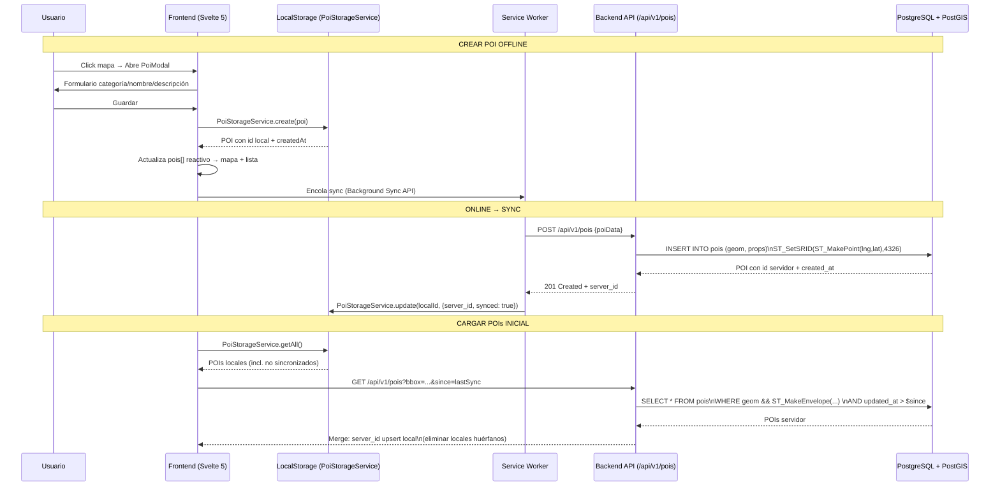

# Plan de Integración Geo/OSM — AYNI Community PWA

**Versión:** 1.0  
**Fecha:** 2026-11-15  
**Alcance:** Frontend (SvelteKit 3 + Svelte 5), Backend (PostgreSQL + PostGIS), PWA Offline-First

---

## 1. Resumen Ejecutivo

Integración completa de **OpenStreetMap (OSM)** + **Geolocalización dual (GPS + IP)** + **Explorador POI** en la app AYNI, reemplazando el mapa CSS Grid actual por tiles reales OSM/Leaflet, añadiendo geocodificación inversa Nominatim, y creando un módulo de geocodificación de emergencia con SVG de provincias peruanas (círculos aproximados: 3 provincias → 24/27).

**Referencia base:** `docs/Geosocial-OSM/` (implementación completa Svelte 5 + Leaflet + LocalStorage CRUD + ISO 25010)

---

## 2. Requerimientos Funcionales (RF)

| ID | Requerimiento | Prioridad | Fuente |
|----|---------------|-----------|--------|
| **RF-GEO-01** | Geolocalización GPS alta precisión (móvil/PWA) con consentimiento explícito | **Crítica** | Geosocial-OSM `GeoLocationService.getGpsLocation()` |
| **RF-GEO-02** | Geolocalización por IP (desktop/fallback) con proveedores públicos (ipwho.is, ipapi.co) | **Crítica** | Geosocial-OSM `GeoLocationService.getIpLocation()` |
| **RF-GEO-03** | Geocodificación inversa OSM Nominatim (lat/lng → ciudad, distrito, dirección) | **Alta** | Geosocial-OSM `GeoLocationService.reverseGeocode()` |
| **RF-GEO-04** | Selección manual de ciudad/preset (offline-first, cache localStorage) | **Media** | Geosocial-OSM `CITY_PRESETS` + `GeoConsentModal` |
| **RF-GEO-05** | Persistencia de última ubicación válida (localStorage + sync backend) | **Alta** | Geosocial-OSM `STORAGE_KEY` + backend `lat_aprox/lng_aprox` |
| **RF-MAP-01** | Mapa interactivo Leaflet con tiles OSM (estándar, Voyager, Dark) | **Crítica** | Geosocial-OSM `Map.svelte` `getTile()` |
| **RF-MAP-02** | Marcador usuario con pulso + círculo de precisión (GPS vs IP vs manual) | **Alta** | Geosocial-OSM `renderUser()` |
| **RF-MAP-03** | POIs categorizados (comida, salud, cultura, etc.) con popups ricos + acciones | **Alta** | Geosocial-OSM `renderMarkers()` + `PoiDetailPopup` |
| **RF-MAP-04** | CRUD POI local (crear/editar/eliminar/favoritos/reseñas) offline-first | **Media** | Geosocial-OSM `PoiStorageService` |
| **RF-MAP-05** | Cálculo distancia Haversine cliente + ordenamiento por proximidad | **Alta** | Geosocial-OSM `calculateDistance()` |
| **RF-MAP-06** | Navegación externa OSM/Google Maps desde popup POI | **Media** | Geosocial-OSM `getDirectionsUrl()` |
| **RF-POI-01** | Explorador POI con filtros (categoría, búsqueda, favoritos, orden) | **Alta** | Geosocial-OSM `PoiList.svelte` + reactive `enrichedPois` |
| **RF-POI-02** | Sincronización POI backend (PostGIS) ↔ frontend (localStorage) | **Media** | Nuevo — requiere API `/api/v1/pois` |
| **RF-POI-03** | Importar/Exportar POIs JSON (backup, migración, compartir) | **Baja** | Geosocial-OSM `exportJson()` / `importJson()` |
| **RF-EMG-01** | Geocodificación emergencia: SVG Perú provincias + círculos aprox. (3 → 24/27) | **Crítica** | **Nuevo requerimiento usuario** |
| **RF-EMG-02** | Selección provincia/distrito en reporte emergencia (sin GPS preciso) | **Alta** | `ReportarEmergencia.svelte` línea 32 |
| **RF-EMG-03** | Guardianes ven ubicación exacta; vecinos ven zona aproximada (privacidad) | **Crítica** | `Mapa.svelte` líneas 105-107, 59 |

---

## 3. Requerimientos No Funcionales (RNF)

| ID | Requerimiento | Métrica/Validación |
|----|---------------|---------------------|
| **RNF-01** | **Privacidad by Design**: GPS solo con consentimiento; IP anonimizada; localStorage only | Auditoría ISO 25010 (Geosocial-OSM `SystemAuditModal`) |
| **RNF-02** | **Offline-First**: Mapa + POIs + geolocalización caché funcionan sin red | Service Worker + IndexedDB + localStorage fallback |
| **RNF-03** | **Performance**: Mapa < 2s carga inicial; POIs < 100ms filtrado reactivo | Lighthouse PWA > 90; Svelte 5 runes reactividad O(1) |
| **RNF-04** | **Accesibilidad**: WCAG 2.1 AA (contraste, foco, ARIA, screen readers) | `Map.svelte` `role="img"`, `aria-label` |
| **RNF-05** | **Seguridad**: CSP permite `*.openstreetmap.org`, `*.tile.openstreetmap.org`, `nominatim.openstreetmap.org`, `ipwho.is`, `ipapi.co` | `frontend/src/app.html` + headers |
| **RNF-06** | **PostGIS Ready**: Backend preparado para consultas espaciales reales (ST_DWithin, ST_Contains) | Migración schema + índices GIST |
| **RNF-07** | **PWA Installable**: Manifest + SW + icons + offline page | Geosocial-OSM `manifest.json` + `OfflineIndicator` |

---

## 4. Casos de Uso (CU)

### CU-GEO-01: Activación Geolocalización Primer Uso (Onboarding)
**Actor:** Usuario nuevo (móvil o desktop)  
**Flujo:**
1. Usuario completa registro → pantalla `Ubicacion.svelte` (Paso 4/4)
2. Sistema detecta plataforma: móvil → prioriza GPS; desktop → prioriza IP
3. Modal consentimiento estilo `GeoConsentModal` (3 pasos: GPS → IP → Manual)
4. Si GPS OK → guarda `provider: 'gps'`, `accuracy` metros, `city` via reverse geocode
5. Si GPS denegado/fallo → fallback IP automático → `provider: 'ip'`, `accuracy ~10km`
6. Si todo falla → lista presets (Lima, Arequipa, Cusco, etc.) → `provider: 'manual'`
7. Guarda en localStorage + envía `lat_aprox/lng_aprox` a backend (redondeado 3 decimales ≈ 100m)
8. Navega a `Zona.svelte` con sector preseleccionado por proximidad (PostGIS `ST_DWithin`)

**Criterios aceptación:** Funciona offline (cached location); respeta permissions-policy `geolocation=(self)`; no envía coords exactas a backend.

### CU-GEO-02: Re-geolocalización / Cambio Zona
**Actor:** Usuario logueado  
**Flujo:** Ajustes → "Actualizar mi zona" → repite CU-GEO-01 → actualiza `app.user.manzana` + backend sector.

### CU-MAP-01: Explorar Mapa Sector (Modo Normal)
**Actor:** Vecino en `Mapa.svelte`  
**Flujo:**
1. Carga Leaflet map centrado en `userLocation.coords` (o sector centroid si manual)
2. Tiles: Carto Voyager (default) / OSM Estándar / Carto Dark (selector UI)
3. Marcador usuario: pulso azul (GPS) / verde (IP) / ámbar (manual) + círculo precisión
4. POIs: Servicios (petróleo) + Favores (morado) + Usuario (azul) — **ahora con coords reales**
5. Click pin → popup rico (nombre, categoría, distancia Haversine, rating, acciones: Ver/Editar/Compartir/Ruta)
6. Filtros: categoría, búsqueda texto, solo favoritos, ordenar (distancia/rating/nuevo/nombre)
7. Lista lateral sincronizada (split view desktop / tabs móvil)

### CU-MAP-02: Crear POI Comunitario
**Actor:** Vecino  
**Flujo:** Click mapa → modal crear POI (categoría, nombre, descripción, foto, tags) → guarda localStorage → sync backend cuando online → aparece en mapa inmediato.

### CU-MAP-03: Navegación Externa
**Actor:** Vecino  
**Flujo:** Popup POI → "Ruta OSM" / "Google Maps" → abre app nativa / web con `getDirectionsUrl()`.

### CU-POI-01: Explorador POI Avanzado
**Actor:** Vecino  
**Flujo:** Panel lateral / pestaña "Lista" → filtros reactivos + búsqueda fuzzy + ordenamiento → click item → centra mapa + abre popup.

### CU-EMG-01: Reporte Emergencia con Geocodificación Provincial
**Actor:** Usuario en emergencia (puede no tener GPS)  
**Flujo:**
1. `ReportarEmergencia.svelte` → selecciona tipo + texto + foto
2. **NUEVO**: Selector "Mi ubicación aproximada" → abre `ProvinciaSelectorModal.svelte`
3. Modal muestra **SVG Perú** con 3 provincias iniciales (Lima, Callao, Provincia Constitucional) con círculos aprox.
4. Usuario click provincia → expande a 24/27 provincias con círculos → click distrito → selecciona
5. Guarda `provincia_id`, `distrito_id`, `lat_aprox`, `lng_aprox` (centroide círculo) en reporte
6. Guardianes ven coords exactas si usuario permitió GPS; vecinos ven solo zona (manzana/distrito)

### CU-EMG-02: Guardianes Responden con Ubicación Precisa
**Actor:** Guardián  
**Flujo:** Recibe alerta → `Mapa.svelte` modo emergencia → ve pedidos (rojo) + grupos apoyo (petróleo) + **su posición GPS precisa** → "Voy yo" → comparte teléfono con solicitante.

---

## 5. Historias de Usuario (US)

| ID | Historia | Puntos | Sprint |
|----|----------|--------|--------|
| **US-GEO-01** | Como usuario móvil, quiero activar GPS de alta precisión para ver servicios cercanos ordenados por distancia real | 5 | 1 |
| **US-GEO-02** | Como usuario desktop, quiero que mi ubicación se aproxime por IP automáticamente sin pedir permisos GPS | 3 | 1 |
| **US-GEO-03** | Como usuario offline, quiero que la app recuerde mi última ubicación válida y funcione sin internet | 3 | 1 |
| **US-GEO-04** | Como usuario preocupado por privacidad, quiero elegir "Solo aproximar por IP" o ciudad manual sin sensores | 3 | 1 |
| **US-MAP-01** | Como vecino, quiero ver un mapa real OSM con tiles, zoom, pan y mi posición con pulso de precisión | 8 | 2 |
| **US-MAP-02** | Como vecino, quiero tocar un servicio/favor en el mapa y ver detalle + distancia real + abrir navegación | 5 | 2 |
| **US-MAP-03** | Como vecino, quiero crear un POI (tienda, parque, farmacia) en el mapa y que aparezca para todos | 5 | 2 |
| **US-POI-01** | Como vecino, quiero filtrar POIs por categoría, buscar por nombre, ver solo favoritos y ordenar por distancia | 5 | 3 |
| **US-POI-02** | Como vecino, quiero exportar/importar mis POIs en JSON para backup o cambiar de dispositivo | 2 | 3 |
| **US-EMG-01** | Como usuario en emergencia sin GPS, quiero seleccionar mi provincia/distrito en un mapa SVG de Perú con círculos aprox. | 8 | 1 |
| **US-EMG-02** | Como Guardián, quiero ver la ubicación exacta de quien pide ayuda (si dio permiso) para ir directo | 5 | 1 |

---

## 6. Diagramas de Programación (Mermaid)

### 6.1 Flujo Geolocalización Dual (GPS + IP + Manual)

```mermaid
flowchart TD
    A[Usuario abre Ubicacion.svelte] --> B{¿Primera vez?}
    B -->|Sí| C[Mostrar GeoConsentModal]
    B -->|No| D[Usar cached location localStorage]
    C --> E[Paso 1: Solicitar GPS\nnavigator.geolocation.getCurrentPosition\n{enableHighAccuracy: true}]
    E -->|Éxito| F[Crear UserLocation\nprovider: 'gps'\naccuracy: pos.coords.accuracy\nreverseGeocode Nominatim]
    E -->|Fallo/Denegado| G[Paso 2: Fallback IP\nfetch ipwho.is → ipapi.co]
    G -->|Éxito| H[Crear UserLocation\nprovider: 'ip'\naccuracy: 10000-12000\ncity/country de API]
    G -->|Fallo| I[Paso 3: Manual\nCITY_PRESETS selector]
    I --> J[Crear UserLocation\nprovider: 'manual'\naccuracy: 25000\ncity preset]
    F --> K[Guardar localStorage\nGeoLocationService.setCachedLocation]
    H --> K
    J --> K
    K --> L[Enviar lat_aprox/lng_aprox redondeados 3 decimales a backend]
    L --> M[Preseleccionar sector en Zona.svelte vía ST_DWithin]
    D --> M
```

### 6.2 Arquitectura Mapa + POI Explorer (Frontend)

```mermaid
flowchart LR
    subgraph UI[Capa UI Svelte 5]
        M[Mapa.svelte\nLeaflet Map Component]
        L[PoiList.svelte\nLista lateral / tabs]
        D[PoiDetailPopup.svelte\nPopup rico]
        C[PoiModal.svelte\nCrear/Editar POI]
        G[GeoConsentModal.svelte\nPermisos ubicación]
    end

    subgraph STATE[Estado Reactivo Runes]
        UL[userLocation: UserLocation]
        PL[pois: POI[]]
        EP[enrichedPois: POI[]\n+ distance Haversine]
        FL[filters: category, search, fav, sort]
    end

    subgraph SERVICES[Servicios]
        GS[GeoLocationService\nGPS + IP + ReverseGeocode]
        PS[PoiStorageService\nLocalStorage CRUD + Seed]
        DS[DistanceUtils\nHaversine + formatDistance]
    end

    subgraph BACKEND[Backend API]
        API_P[/api/v1/pois\nPOST GET PUT DELETE]
        API_S[/api/v1/sectores/buscar\nPOST lat/lng → sector]
        API_E[/api/v1/emergencias\nPOST reporte + provincia]
    end

    UL --> M
    UL --> L
    PL --> PS
    PS --> PL
    PL --> EP
    FL --> EP
    EP --> M
    EP --> L
    M -->|click| C
    M -->|click pin| D
    L -->|click item| M
    L -->|click item| D
    C -->|save| PS
    C -->|sync| API_P
    GS --> UL
    GS -->|reverseGeocode| Nominatim[(Nominatim OSM)]
    GS -->|IP| IPAPI[(ipwho.is / ipapi.co)]
    DS --> EP
    API_S -->|sector| UL
```

### 6.3 Flujo Emergencia + Geocodificación Provincial SVG

```mermaid
flowchart TD
    A[Usuario pulsa Reportar Emergencia] --> B[ReportarEmergencia.svelte]
    B --> C{Tipo emergencia\nseleccionado}
    C -->|Sí| D[Campo: Ubicación aproximada]
    D --> E[Click selector → Abre ProvinciaSelectorModal]
    
    subgraph SVG_MODAL[ProvinciaSelectorModal.svelte]
        F[SVG Perú provincias\nviewBox=\"0 0 1000 1200\"]
        F1[Fase 1: 3 provincias\nLima, Callao, Prov. Const.\nCírculos radio ~50km]
        F2[Click provincia → Fase 2\n24/27 provincias\nCírculos radio ~25km]
        F3[Click provincia → Lista distritos\nSelect nativo / chips]
        F4[Selección → lat/lng centroide círculo\n+ provincia_id + distrito_id]
    end
    
    E --> F
    F --> F1
    F1 -->|click| F2
    F2 -->|click| F3
    F3 --> F4
    F4 --> G[Cierra modal\nRellena campos ocultos]
    G --> H[Usuario completa texto/foto]
    H --> I[Enviar reporte\nacciones.reportarEmergencia]
    I --> J[Backend: emergencias.ts\nGuarda lat_aprox/lng_aprox\n+ provincia_id/distrito_id]
    J --> K[Notifica Guardianes\nWebSocket / Push]
    K --> L[Guardianes ven Mapa.svelte modo emergencia]
    L --> M{¿Usuario dio GPS?}
    M -->|Sí| N[Marcador exacto + teléfono]
    M -->|No| O[Marcador zona aprox.\nsolo manzana/distrito]
```

### 6.4 Sincronización Offline-First POI (LocalStorage ↔ PostGIS)



### 6.5 Backend PostGIS – Consultas Espaciales Preparadas

```mermaid
flowchart TD
    subgraph SCHEMA[Esquema PostgreSQL + PostGIS]
        T1[sectores\n- id, nombre, area_geojson (geometry)\n- índice GIST ON area_geojson]
        T2[pois\n- id, nombre, categoria, geom (geometry(Point,4326))\n- props jsonb, server_id, synced_at\n- índice GIST ON geom]
        T3[emergencias\n- id, tipo, geom (geometry(Point,4326))\n- provincia_id, distrito_id\n- lat_aprox, lng_aprox\n- índice GIST ON geom]
        T4[provincias_peru\n- id, nombre, codigo_inei\n- geom (geometry(MultiPolygon,4326))\n- círculo_aprox geometry(Circle,4326)\n- índice GIST ON geom, círculo_aprox]
        T5[distritos_peru\n- id, nombre, provincia_id\n- geom (geometry(MultiPolygon,4326))\n- índice GIST ON geom]
    end

    subgraph QUERIES[Consultas Clave]
        Q1[sectorPorUbicacion\nST_Contains(area_geojson, ST_MakePoint(lng,lat))]
        Q2[poisCercanos\nST_DWithin(geom, ST_MakePoint(lng,lat), radio_metros)\nORDER BY geom <-> ST_MakePoint(lng,lat)\nLIMIT 50]
        Q3[emergenciaZona\nST_DWithin(emergencias.geom, sectores.area_geojson, 0)\nJOIN guardianes]
        Q4[provinciaSelector\nSELECT * FROM provincias_peru\nWHERE ST_Contains(círculo_aprox, ST_MakePoint(lng,lat))\nOR fase=1 LIMIT 3]
    end

    T1 --> Q1
    T2 --> Q2
    T3 --> Q3
    T4 --> Q4
    T5 --> Q4
```

---

## 7. Plan de Implementación por Fases

### Fase 1: Geolocalización Dual + Emergencia Provincial (Semanas 1-2) — **CRÍTICA**

| Tarea | Archivos Objetivo | Descripción |
|-------|-------------------|-------------|
| **1.1** | `frontend/src/lib/servicios/geoService.ts` (nuevo) | Portar `GeoLocationService` de Geosocial-OSM: GPS + IP (ipwho.is/ipapi.co) + Nominatim reverse + cache localStorage + CITY_PRESETS (añadir ciudades Perú: Lima, Arequipa, Trujillo, Chiclayo, Piura, Cusco, Huancayo, Iquitos, Juliaca, Tacna) |
| **1.2** | `frontend/src/lib/pantallas/acceso/Ubicacion.svelte` | Reescribir: integrar `GeoConsentModal` (portar de Geosocial-OSM), usar `geoService`, enviar `lat_aprox/lng_aprox` redondeados 3 decimales a `registrar()` |
| **1.3** | `frontend/src/lib/ui/GeoConsentModal.svelte` (nuevo) | Portar modal 3 pasos: GPS → IP → Manual con presets Perú |
| **1.4** | `frontend/src/lib/pantallas/emergencia/ProvinciaSelectorModal.svelte` (nuevo) | **SVG Perú provincias** — ver sección 8. Círculos aprox. Fase 1 (3 prov) → Fase 2 (24/27) |
| **1.5** | `frontend/src/lib/pantallas/emergencia/ReportarEmergencia.svelte` | Integrar selector provincia/distrito; guardar `provincia_id`, `distrito_id`, `lat_aprox`, `lng_aprox` |
| **1.6** | `backend/src/lib/server/repositorios/provincias.ts` (nuevo) | Repositorio PostGIS: `buscarPorPunto(lat,lng)`, `listarFase1()`, `listarTodas()`, `distritosDe(provinciaId)` |
| **1.7** | `backend/migraciones/002_provincias_peru.sql` (nuevo) | Tabla `provincias_peru` + `distritos_peru` con `geom` + `circulo_aprox` (geometría círculo ~25-50km) + datos INEI 24/27 provincias |
| **1.8** | `backend/src/routes/api/v1/provincias/` (nuevo) | Endpoints: `GET /buscar?lat&lng`, `GET /fase1`, `GET /:id/distritos` |
| **1.9** | `frontend/src/app.html` + `vite.config.ts` | CSP: añadir `https://nominatim.openstreetmap.org`, `https://ipwho.is`, `https://ipapi.co`, `https://*.tile.openstreetmap.org`, `https://*.basemaps.cartocdn.com` |

### Fase 2: Mapa Leaflet + POI Explorer (Semanas 3-4)

| Tarea | Archivos Objetivo | Descripción |
|-------|-------------------|-------------|
| **2.1** | `frontend/package.json` | Añadir deps: `leaflet`, `@types/leaflet`, `lucide-svelte` (ya está), `canvas-confetti` (opcional) |
| **2.2** | `frontend/src/lib/pantallas/Mapa.svelte` | **Reescritura completa**: Leaflet Map con tiles OSM/Voyager/Dark, marcadores reales, popups ricos, controles zoom/capas/centrar |
| **2.3** | `frontend/src/lib/components/mapa/MapaLeaflet.svelte` (nuevo) | Componente aislado Leaflet (portar de Geosocial-OSM `Map.svelte`) |
| **2.4** | `frontend/src/lib/components/mapa/PoiList.svelte` (nuevo) | Portar `PoiList.svelte` con filtros reactivos Svelte 5 runes |
| **2.5** | `frontend/src/lib/components/mapa/PoiDetailPopup.svelte` (nuevo) | Portar popup rico con acciones Ver/Editar/Compartir/Ruta OSM/Google |
| **2.6** | `frontend/src/lib/components/mapa/PoiModal.svelte` (nuevo) | Portar modal crear/editar POI con categorías, tags, foto |
| **2.7** | `frontend/src/lib/servicios/poiService.ts` (nuevo) | Portar `PoiStorageService` + añadir `syncConBackend()` (Background Sync) |
| **2.8** | `frontend/src/lib/types/poi.ts` (nuevo) | Portar tipos: `Category`, `POI`, `Coordinates`, `UserLocation`, `Review`, `CategoryMeta` |
| **2.9** | `frontend/src/lib/utils/distance.ts` (nuevo) | Portar `calculateDistance` (Haversine), `formatDistance`, `getCardinalBearing`, `getDirectionsUrl` |
| **2.10** | `backend/src/routes/api/v1/pois/` (nuevo) | CRUD POIs con PostGIS: `GET?bbox=&category=`, `POST`, `PUT`, `DELETE`, `GET /sync?since=` |
| **2.11** | `backend/migraciones/003_pois_postgis.sql` (nuevo) | Tabla `pois` con `geom geometry(Point,4326)`, `props jsonb`, índices GIST, trigger `updated_at` |
| **2.12** | `frontend/src/lib/pantallas/servicios/comun.js` | Reemplazar `serviciosVisibles()` fake distance → `calculateDistance` real + filtro por radio configurable |

### Fase 3: Sincronización Offline-First + PWA Hardening (Semanas 5-6)

| Tarea | Archivos Objetivo | Descripción |
|-------|-------------------|-------------|
| **3.1** | `frontend/public/sw.js` (nuevo/mejorar) | Workbox/Service Worker: cache tiles OSM (stale-while-revalidate), cache POIs, Background Sync API para POIs pendientes |
| **3.2** | `frontend/src/lib/servicios/syncService.ts` (nuevo) | Cola de operaciones offline → sync al reconectar + resolución conflictos (last-write-wins + server_id) |
| **3.3** | `frontend/src/lib/components/OfflineIndicator.svelte` | Portar de Geosocial-OSM: badge online/offline + contador pendientes |
| **3.4** | `frontend/public/manifest.json` | Verificar icons, shortcuts, `display: standalone`, `orientation: portrait` |
| **3.5** | `backend/src/lib/server/servicios/emergencias.ts` | Integrar `provincia_id`/`distrito_id` en alertas; notificar Guardianes con zona precisa/aproximada según permisos |
| **3.6** | Tests: `frontend/src/lib/servicios/geoService.test.ts`, `poiService.test.ts`, `distance.test.ts` | Vitest: Haversine, GPS/IP fallback, reverse geocode mock, POI CRUD, sync queue |

### Fase 4: Auditoría ISO 25010 + Documentación (Semana 7)

| Tarea | Archivos Objetivo | Descripción |
|-------|-------------------|-------------|
| **4.1** | `frontend/src/lib/components/SystemAuditModal.svelte` | Portar de Geosocial-OSM: suite pruebas en vivo (GPS, IP, Map load, POI CRUD, Sync, Emergencia) |
| **4.2** | `docs/ISO-25010-MATRIZ.md` | Matriz calidad: Funcionalidad, Usabilidad, Rendimiento, Seguridad, Compatibilidad, Mantenibilidad, Portabilidad |
| **4.3** | `docs/GEO-OSM-INTEGRACION.md` | Documentación técnica completa: APIs, flujos, diagramas, troubleshooting |

---

## 8. Especificación SVG Perú Provincias + Círculos Aproximados

### 8.1 Requisitos Visuales

| Fase | Provincias | Círculo Radio | Caso Uso |
|------|------------|---------------|----------|
| **Fase 1 (Inicial)** | 3: Lima, Callao, Provincia Constitucional | ~50 km | Usuario abre selector primera vez — decisión rápida zona macro |
| **Fase 2 (Expandida)** | 24/27 provincias (todas INEI) | ~25 km | Usuario click provincia → ve sub-división distrital |

### 8.2 Estructura SVG Sugerida

```xml
<!-- public/assets/peru-provincias.svg -->
<svg viewBox="0 0 1000 1200" xmlns="http://www.w3.org/2000/svg">
  <!-- Capa base: límites provinciales (path) -->
  <g id="provincia-limites">
    <path id="prov-1501" data-codigo="1501" data-nombre="Lima" d="..." />
    <path id="prov-0701" data-codigo="0701" data-nombre="Callao" d="..." />
    <!-- ... 24/27 paths -->
  </g>
  
  <!-- Capa círculos aproximados Fase 1 (3 provincias) -->
  <g id="circulos-fase1" class="fase-1">
    <circle id="circ-1501" cx="520" cy="680" r="45" data-provincia="1501" />
    <circle id="circ-0701" cx="500" cy="660" r="30" data-provincia="0701" />
    <circle id="circ-XX" cx="..." cy="..." r="..." data-provincia="XX" />
  </g>
  
  <!-- Capa círculos aproximados Fase 2 (todas) - oculta initially -->
  <g id="circulos-fase2" class="fase-2" style="display:none">
    <circle id="circ-1501-f2" cx="520" cy="680" r="22" data-provincia="1501" />
    <!-- ... todos -->
  </g>
  
  <!-- Centroides para fallback coordenadas -->
  <g id="centroides" style="display:none">
    <circle id="cent-1501" cx="520" cy="680" r="3" data-lat="-12.0464" data-lng="-77.0428" />
    <!-- ... -->
  </g>
</svg>
```

### 8.3 Lógica Componente `ProvinciaSelectorModal.svelte`

```typescript
// Estados
let fase: 1 | 2 = 1;
let provinciaSeleccionada: string | null = null;
let distritoSeleccionado: string | null = null;

// Eventos
function handleProvinciaClick(codigo: string) {
  if (fase === 1) {
    provinciaSeleccionada = codigo;
    fase = 2; // Expande a 24/27 + muestra distritos de esa provincia
    cargarDistritos(codigo);
  } else {
    provinciaSeleccionada = codigo;
    cargarDistritos(codigo);
  }
}

function handleDistritoClick(codigo: string) {
  distritoSeleccionado = codigo;
  const centroide = obtenerCentroide(codigo); // del SVG o backend
  onSeleccion({ provinciaId: provinciaSeleccionada, distritoId: codigo, ...centroide });
  close();
}
```

### 8.4 Datos INEI 2024 (24 departamentos + 1 provincia constitucional + Callao = 26 unidades)

Provincias a incluir (código INEI, nombre, capital, lat/lng aproximado centroide):
- 0101 Amazonas (Chachapoyas), 0201 Ancash (Huaraz), 0301 Apurímac (Abancay), 0401 Arequipa (Arequipa), 0501 Ayacucho (Ayacucho), 0601 Cajamarca (Cajamarca), 0701 Callao (Callao), 0801 Cusco (Cusco), 0901 Huancavelica (Huancavelica), 1001 Huánuco (Huánuco), 1101 Ica (Ica), 1201 Junín (Huancayo), 1301 La Libertad (Trujillo), 1401 Lambayeque (Chiclayo), 1501 Lima (Lima), 1601 Loreto (Iquitos), 1701 Madre de Dios (Puerto Maldonado), 1801 Moquegua (Moquegua), 1901 Pasco (Cerro de Pasco), 2001 Piura (Piura), 2101 Puno (Puno), 2201 San Martín (Moyobamba), 2301 Tacna (Tacna), 2401 Tumbes (Tumbes), 2501 Ucayali (Pucallpa), **Prov. Constitucional del Callao** (ya en 0701).

*Nota: 27 si se separan provincias dentro de departamentos (ej. Lima Metropolitana vs Lima Provincias). Usar shapefile INEI oficial para paths SVG.*

---

## 9. Migraciones Base de Datos (Resumen)

```sql
-- 002_provincias_peru.sql
CREATE EXTENSION IF NOT EXISTS postgis;

CREATE TABLE provincias_peru (
  id VARCHAR(6) PRIMARY KEY,           -- código INEI ej: '1501'
  nombre VARCHAR(100) NOT NULL,
  departamento_id VARCHAR(2) NOT NULL, -- ej: '15'
  capital VARCHAR(100),
  geom GEOMETRY(MultiPolygon, 4326),   -- límite exacto INEI
  circulo_aprox GEOMETRY(Circle, 4326),-- círculo ~25km para selector
  circulo_fase1 GEOMETRY(Circle, 4326),-- círculo ~50km (solo 3 prov)
  poblacion INT,
  creado_en TIMESTAMPTZ DEFAULT NOW()
);
CREATE INDEX idx_provincias_geom ON provincias_peru USING GIST (geom);
CREATE INDEX idx_provincias_circulo ON provincias_peru USING GIST (circulo_aprox);

CREATE TABLE distritos_peru (
  id VARCHAR(6) PRIMARY KEY,           -- código INEI ej: '150101'
  provincia_id VARCHAR(6) REFERENCES provincias_peru(id),
  nombre VARCHAR(100) NOT NULL,
  geom GEOMETRY(MultiPolygon, 4326),
  centroide GEOMETRY(Point, 4326),     -- ST_Centroid(geom)
  creado_en TIMESTAMPTZ DEFAULT NOW()
);
CREATE INDEX idx_distritos_geom ON distritos_peru USING GIST (geom);
CREATE INDEX idx_distritos_provincia ON distritos_peru (provincia_id);

-- 003_pois_postgis.sql
CREATE TABLE pois (
  id UUID PRIMARY KEY DEFAULT gen_random_uuid(),
  server_id UUID UNIQUE,               -- para sync
  nombre VARCHAR(200) NOT NULL,
  categoria VARCHAR(30) NOT NULL,      -- food, shop, health, etc.
  descripcion TEXT,
  direccion VARCHAR(300),
  telefono VARCHAR(30),
  website VARCHAR(300),
  rating NUMERIC(2,1) DEFAULT 5.0,
  tags TEXT[],
  es_favorito BOOLEAN DEFAULT FALSE,
  geom GEOMETRY(Point, 4326) NOT NULL, -- ST_SetSRID(ST_MakePoint(lng, lat), 4326)
  props JSONB DEFAULT '{}',            -- extensible
  creado_en TIMESTAMPTZ DEFAULT NOW(),
  actualizado_en TIMESTAMPTZ DEFAULT NOW(),
  sincronizado_en TIMESTAMPTZ,
  creado_por UUID REFERENCES usuarios(id)
);
CREATE INDEX idx_pois_geom ON pois USING GIST (geom);
CREATE INDEX idx_pois_categoria ON pois (categoria);
CREATE INDEX idx_pois_sincronizado ON pois (sincronizado_en) WHERE sincronizado_en IS NOT NULL;

-- Trigger updated_at
CREATE OR REPLACE FUNCTION update_updated_at() RETURNS TRIGGER AS $$
BEGIN NEW.actualizado_en = NOW(); RETURN NEW; END; $$ LANGUAGE plpgsql;
CREATE TRIGGER trigger_pois_updated_at BEFORE UPDATE ON pois FOR EACH ROW EXECUTE FUNCTION update_updated_at();
```

---

## 10. Configuración CSP Requerida (`frontend/src/app.html`)

```html
<meta http-equiv="Content-Security-Policy" content="
  default-src 'self';
  script-src 'self' 'unsafe-inline' https://cdn.tailwindcss.com;
  style-src 'self' 'unsafe-inline' https://fonts.googleapis.com https://*.tile.openstreetmap.org https://*.basemaps.cartocdn.com;
  img-src 'self' data: blob: https://*.tile.openstreetmap.org https://*.basemaps.cartocdn.com https://nominatim.openstreetmap.org;
  connect-src 'self' https://nominatim.openstreetmap.org https://ipwho.is https://ipapi.co https://*.tile.openstreetmap.org https://*.basemaps.cartocdn.com wss://*.supabase.co;
  font-src 'self' https://fonts.gstatic.com;
  frame-src 'self' https://www.openstreetmap.org https://www.google.com;
  manifest-src 'self';
">
```

---

## 11. Validación y Pruebas de Aceptación

| Escenario | Criterio Éxito | Herramienta |
|-----------|----------------|-------------|
| GPS móvil permiso concedido | `provider: 'gps'`, `accuracy < 50m`, ciudad resuelta Nominatim | Vitest + Playwright mobile emulation |
| GPS denegado → fallback IP | `provider: 'ip'`, `accuracy ~10km`, ciudad de ipwho.is | Mock `navigator.geolocation` error |
| Sin red → cached location | Usa `localStorage` último válido, muestra preset Lima | Offline DevTools |
| Mapa carga tiles OSM | 200 OK tiles, zoom/pan fluido, 3 estilos cambian | Lighthouse + visual |
| POI creado offline → sync online | Appears local inmediato; Background Sync envía al reconectar; server_id asignado | Service Worker DevTools |
| Emergencia selector provincia | SVG renderiza, click fase1→fase2, distrito selectable, coords guardadas | Playwright E2E |
| Guardian ve ubicación exacta | Si usuario GPS → marker preciso + teléfono; si IP/manual → zona aprox | Test integración backend |
| PostGIS ST_DWithin pois | Query < 50ms para 10k POIs radio 2km | EXPLAIN ANALYZE |

---

## 12. Riesgos y Mitigaciones

| Riesgo | Probabilidad | Impacto | Mitigación |
|--------|--------------|---------|------------|
| Nominatim rate limit (1 req/s) | Alta | Medio | Cache localStorage 24h; fallback IP city; debounce 500ms |
| ipwho.is/ipapi.co caídos | Media | Alto | Dual provider + cached location + presets manuales |
| SVG Perú peso > 500KB | Media | Medio | Simplificar paths (Simplify GeoJSON 0.01°); gzip + cache SW |
| PostGIS no disponible en hosting | Baja | Crítico | Verificar extensión al deploy; fallback ray-casting actual |
| Service Worker no registra en iOS Safari | Media | Alto | Test real iOS; fallback localStorage-only mode |
| Permissions-Policy geolocation bloquea iframe | Baja | Medio | `geolocation=(self)` ya configurado; verificar headers |

---

## 13. Dependencias Nuevas (package.json)

### Frontend
```json
{
  "dependencies": {
    "leaflet": "^1.9.4",
    "@types/leaflet": "^1.9.22",
    "lucide-svelte": "^1.0.1",
    "canvas-confetti": "^1.9.4",
    "@types/canvas-confetti": "^1.9.0"
  }
}
```

### Backend (ya tiene `pg`, añadir tipos PostGIS si usa ORM)
```json
{
  "devDependencies": {
    "@types/pg": "^8.11.0"
  }
}
```

---

## 14. Checklist de Entrega por Fase

### Fase 1 ✓
- [ ] `geoService.ts` funcional (GPS + IP + Nominatim + cache + presets Perú)
- [ ] `GeoConsentModal.svelte` 3 pasos integrada en `Ubicacion.svelte`
- [ ] `ProvinciaSelectorModal.svelte` con SVG Perú fases 1→2
- [ ] Backend provincias/distritos PostGIS + API
- [ ] CSP actualizado + headers permissions-policy

### Fase 2 ✓
- [ ] `MapaLeaflet.svelte` reemplaza CSS Grid map
- [ ] `PoiList.svelte` + `PoiDetailPopup.svelte` + `PoiModal.svelte`
- [ ] `poiService.ts` LocalStorage CRUD + seed adaptativo
- [ ] Backend POIs PostGIS CRUD + sync endpoint
- [ ] `comun.js` distancia real Haversine

### Fase 3 ✓
- [ ] Service Worker cache tiles + POIs + Background Sync
- [ ] `OfflineIndicator.svelte` + `syncService.ts`
- [ ] PWA manifest + icons válidos
- [ ] Tests unitarios + E2E críticos

### Fase 4 ✓
- [ ] `SystemAuditModal.svelte` suite pruebas en vivo
- [ ] Matriz ISO 25010 documentada
- [ ] Docs técnicas completas

---

## 15. Notas de Integración con Código Existente

| Componente Actual | Cambio | Compatibilidad |
|-------------------|--------|----------------|
| `Ubicacion.svelte` | Reemplazar `navigator.geolocation` simple → `geoService` + modal | Breaking: cambia flujo onboarding |
| `Mapa.svelte` | Reescribir completo: CSS Grid → Leaflet | Breaking: nueva API props (`userLocation`, `pois`, `onMapClick`, etc.) |
| `Zona.svelte` | Preseleccionar sector por `lat_aprox/lng_aprox` (ya hace `cargarSectoresPublicos`) | Compatible: usa mismo endpoint `/api/v1/sectores/buscar` |
| `ReportarEmergencia.svelte` | Añadir selector provincia/distrito (opcional, mejora UX) | Aditivo: campos ocultos `provincia_id`, `distrito_id` |
| `comun.js` `serviciosVisibles()` | Reemplazar `cuadras()` fake → `calculateDistance()` real | Breaking: necesita `userLocation` real |
| `util.js` `cuadras()` / `posicionPin()` | Mantener para compatibilidad legado (mapa viejo) | Legacy: deprecado, no eliminar |
| `acciones.js` `registrar()` | Aceptar `location` + `provincia_id` + `distrito_id` | Aditivo: campos opcionales |
| Backend `sectores/buscar` | Ya usa PostGIS point-in-polygon → compatible | Sin cambios |

---

**Fin del Plan** — Listo para implementación por fases. Cada fase es desplegable independientemente con feature flags.