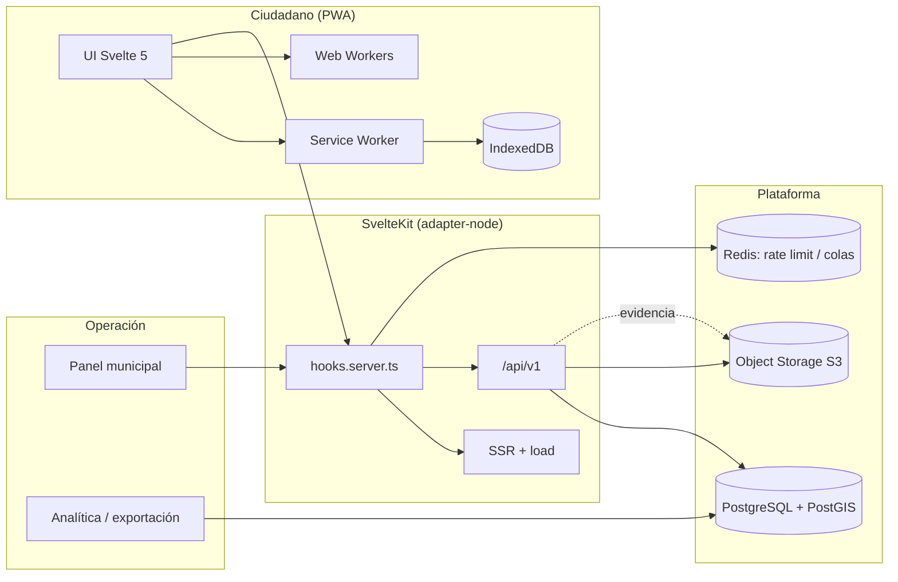

# 02 · Arquitectura

> **Decisión general:** PWA offline-first con SvelteKit 3, capa de dominio aislada, repositorios con puertos y adaptadores, API REST contrato-primero y PostgreSQL/PostGIS como fuente de verdad.

---

## 1. Principios

1. **El cliente es una réplica, no la verdad.** IndexedDB guarda lo necesario para trabajar offline; PostgreSQL es la fuente de verdad cuando hay red.
2. **El dominio no conoce SvelteKit, IndexedDB ni HTTP.** Se puede testear con Vitest sin navegador ni servidor.
3. **El contrato manda.** OpenAPI define la API; los tipos se generan y se validan en runtime.
4. **SSR por defecto, CSR donde aporta.** Las pantallas públicas y el panel se renderizan en servidor; el reporte y la cola offline son cliente.
5. **Seguridad en el borde.** `hooks.server.ts` aplica sesión, RBAC, cabeceras, rate limit y trazabilidad antes de tocar rutas.
6. **Todo lo que se guarda se puede borrar.** Retención, exportación y eliminación por diseño (Ley 29733).

---

## 2. Vista de contexto



### Flujo 1 — Reporte con señal

1. El usuario completa categoría, foto, ubicación y descripción.
2. El worker comprime y difumina la imagen; calcula hash perceptual.
3. El repositorio crea un `Incident` en estado `draft` en IndexedDB y encola un `OutboxOp`.
4. El sincronizador envía `POST /api/v1/incidents` con `Idempotency-Key`.
5. La API valida, persiste, sube evidencia a S3 y devuelve `201` con `id`, `code` y `status`.
6. El repositorio actualiza el registro local y marca la operación como `done`.

### Flujo 2 — Reporte sin señal

1. Se guarda todo en IndexedDB (`draft` → `queued`).
2. La UI muestra "Guardado en tu dispositivo. Se enviará cuando vuelvas a tener señal."
3. El service worker registra `sync` si el navegador lo soporta; si no, el cliente reintenta al evento `online`.
4. Al sincronizar, se aplica backoff exponencial con jitter y se respeta el orden por `created_at`.
5. Si el servidor devuelve `409` por duplicado, se vincula al caso existente y se notifica.

### Flujo 3 — Panel municipal

1. `+page.server.ts` carga la bandeja con filtros por estado, categoría, distrito y SLA.
2. `hooks.server.ts` valida sesión y rol `operator`/`supervisor`.
3. El operador agrupa duplicados, asigna cuadrilla y cambia estado.
4. Cada cambio genera un `StatusEvent` inmutable y una entrada de auditoría.

---

## 3. Capas y responsabilidades

| Capa | Ubicación propuesta | Responsabilidad | Puede importar |
|---|---|---|---|
| Dominio | `src/lib/domain/` | Entidades, value objects, estados, reglas, políticas de SLA | Nada de infraestructura |
| Aplicación | `src/lib/application/` | Casos de uso: crear reporte, triar, asignar, cerrar, confirmar | Dominio + puertos |
| Puertos | `src/lib/application/ports/` | Interfaces de repositorios, reloj, IDs, almacenamiento | Dominio |
| Adaptadores | `src/lib/infra/` | HTTP, IndexedDB, S3, Postgres, workers | Puertos + librerías |
| UI | `src/lib/components/`, `src/rutas/` | Componentes, páginas, formularios, estados de carga | Aplicación |
| Borde | `src/hooks.server.ts`, `src/rutas/api/` | Sesión, RBAC, validación, rate limit, contrato | Aplicación + infra |
| Service Worker | `src/service-worker/` | Caché, offline shell, sync, push | `$app/*` |

Regla de dependencia: **las flechas apuntan hacia el dominio**. Si un componente importa Drizzle o `fetch`, la frontera está mal.

---

## 4. Mapa de carpetas objetivo

```text
src/
├─ env.ts                          # defineEnvVars (SvelteKit 3)
├─ app.d.ts                        # App.Locals, PageData, Error
├─ hooks.server.ts                 # sesión, RBAC, headers, rate limit
├─ hooks.client.ts                 # telemetría de errores
├─ service-worker/
│  ├─ index.ts                     # precache + runtime caching + sync
│  └─ tsconfig.json                # $app/tsconfig/service-worker
├─ lib/
│  ├─ domain/
│  │  ├─ incidents/
│  │  │  ├─ incident.ts            # entidad + invariantes
│  │  │  ├─ status.ts              # máquina de estados
│  │  │  ├─ category.ts
│  │  │  └─ sla.ts
│  │  ├─ evidence/evidence.ts
│  │  └─ shared/{id.ts,clock.ts,geo.ts,result.ts}
│  ├─ application/
│  │  ├─ ports/{incident-repository.ts,evidence-store.ts,sync-queue.ts}
│  │  └─ use-cases/{report-incident.ts,triage-incident.ts,close-incident.ts}
│  ├─ infra/
│  │  ├─ http/{api-client.ts,incident-http-repository.ts}
│  │  ├─ idb/{db.ts,incident-idb-repository.ts,outbox.ts}
│  │  ├─ workers/{image.worker.ts,hash.worker.ts,worker-pool.ts}
│  │  └─ server/{db.ts,incident-postgres-repository.ts,storage.ts}
│  ├─ components/                  # kit existente
│  ├─ stores/                      # estado de UI (runes/stores)
│  └─ utils/
├─ rutas/
│  ├─ (public)/                    # home, ayuda, privacidad
│  ├─ (app)/reportar/              # flujo de reporte
│  ├─ (app)/casos/[code]/          # seguimiento
│  ├─ (panel)/bandeja/             # operador
│  ├─ (panel)/mapa/
│  ├─ api/v1/
│  │  ├─ incidents/+server.ts
│  │  ├─ incidents/[id]/+server.ts
│  │  ├─ incidents/[id]/status/+server.ts
│  │  ├─ uploads/sign/+server.ts
│  │  ├─ stats/summary/+server.ts
│  │  └─ health/+server.ts
│  └─ api/docs/+page.svelte        # Swagger UI (solo staging/dev)
└─ service-worker/
```

> El kit actual (`src/lib/components`) se conserva; se recomienda moverlo a `src/lib/ui/components` solo cuando el equipo lo decida, para evitar un rename masivo innecesario.

---

## 5. Modelo de dominio

### 5.1 Entidades

| Entidad | Campos clave | Invariantes |
|---|---|---|
| `Incident` | `id` (UUIDv7), `code` (legible), `category`, `severity`, `status`, `location`, `description`, `createdAt`, `updatedAt`, `reportedBy` (seudónimo) | `code` único; `status` solo avanza por transiciones válidas; `location` siempre aproximada |
| `Evidence` | `id`, `incidentId`, `kind` (photo/audio), `blobKey`, `hash`, `width`, `height`, `blurred` | Una evidencia pertenece a un incidente; hash único por incidente |
| `StatusEvent` | `id`, `incidentId`, `from`, `to`, `actorId`, `note`, `createdAt` | Inmutable; nunca se edita ni se borra |
| `Confirmation` | `id`, `incidentId`, `deviceHash`, `createdAt` | Un dispositivo confirma una vez por incidente |
| `Assignment` | `id`, `incidentId`, `teamId`, `assignedAt`, `dueAt` | Un incidente tiene una asignación activa como máximo |
| `Category` | `id`, `slug`, `name`, `slaHours`, `requiresEvidence`, `sensitive` | `sensitive` excluye del mapa público |
| `Actor` | `id`, `role`, `districtId`, `displayName` | Roles: `citizen`, `operator`, `supervisor`, `admin` |

### 5.2 Máquina de estados

```text
draft ──submit──▶ submitted ──triage──▶ triaged ──assign──▶ assigned
  │                  │                    │                    │
  │                  ├──duplicate────────▶ merged               │
  │                  └──reject───────────▶ rejected             │
  │                                                             ▼
  └──discard──▶ discarded                              in_progress
                                                             │
                                              ┌──────────────┼──────────────┐
                                              ▼              ▼              ▼
                                          resolved       unresolved      cancelled
                                              │
                                              ▼
                                          verified ──▶ closed
```

Reglas:

- `submitted → triaged` exige categoría y ubicación válidas.
- `assigned → in_progress` exige asignación activa.
- `resolved → verified` exige evidencia de cierre (foto o nota).
- `verified → closed` solo lo hace `supervisor` o `admin`.
- Cualquier transición genera `StatusEvent` y evento de auditoría.
- `sensitive = true` nunca aparece en endpoints públicos de mapa.

### 5.3 Relaciones

```text
Category 1 ─── n Incident
Incident 1 ─── n Evidence
Incident 1 ─── n StatusEvent
Incident 1 ─── n Confirmation
Incident 1 ─── 0..1 Assignment
Actor    1 ─── n StatusEvent
District 1 ─── n Incident
```

---

## 6. Arquitectura de datos

### 6.1 Servidor

- **PostgreSQL 16+** con **PostGIS** para `geography(Point, 4326)` e índices GiST.
- **Drizzle ORM** para consultas tipadas y migraciones versionadas.
- **S3 compatible** (MinIO en local, R2/S3 en producción) para evidencias; la base guarda solo metadatos y `blobKey`.
- **Redis** para rate limit distribuido, locks de sincronización y colas ligeras.

Índices mínimos:

```sql
CREATE INDEX incidents_status_created_idx ON incidents (status, created_at DESC);
CREATE INDEX incidents_category_created_idx ON incidents (category_id, created_at DESC);
CREATE INDEX incidents_location_gist_idx ON incidents USING GIST (location);
CREATE UNIQUE INDEX incidents_code_uidx ON incidents (code);
CREATE UNIQUE INDEX confirmations_unique_idx ON confirmations (incident_id, device_hash);
```

### 6.2 Cliente

- **IndexedDB** con la librería `idb` (promesas, tipado, migraciones simples).
- Stores: `incidents`, `evidence`, `outbox`, `categories`, `meta`.
- Evidencias se guardan como `Blob` comprimido; nunca en `localStorage`.
- Límite de cuota: estimar con `navigator.storage.estimate()` y pedir persistencia.
- Política de evicción: borrar evidencias sincronizadas con más de 30 días; nunca borrar `outbox` pendiente.

### 6.3 Consistencia

| Escenario | Estrategia |
|---|---|
| Dos dispositivos editan el mismo caso | `version` monotónica + `409` con estado actual |
| Reporte duplicado | Hash perceptual + distancia geoespacial + ventana temporal |
| Sync parcial | Outbox con estados `pending`, `inflight`, `done`, `failed`, `conflict` |
| Servidor caído | Reintentos con backoff y `Retry-After` |
| Reloj del dispositivo incorrecto | `created_at` del servidor manda; el cliente guarda `client_created_at` solo para orden local |

---

## 7. API y contrato

- Prefijo `/api/v1`.
- JSON con `Content-Type: application/json; charset=utf-8`.
- Errores con **RFC 9457 Problem Details** (`application/problem+json`).
- Paginación por cursor (`?cursor=...&limit=...`), nunca offset para listas grandes.
- `Idempotency-Key` obligatorio en `POST /incidents` y `POST /confirmations`.
- `ETag`/`If-None-Match` en lecturas públicas.
- Rate limit por IP + dispositivo + usuario, con cabeceras `RateLimit-*`.
- OpenAPI 3.1 en `openapi/openapi.yaml`; Swagger UI en `/api/docs` solo en dev/staging.

El contrato completo, con esquemas y ejemplos, está en [08-api-openapi-swagger.md](08-api-openapi-swagger.md).

---

## 8. Seguridad de la arquitectura

| Superficie | Control |
|---|---|
| Sesión | Cookie `HttpOnly`, `Secure`, `SameSite=Lax`, rotación al login |
| Contraseñas | Argon2id; nunca SHA-256 simple |
| CSRF | Verificación de origen de SvelteKit 3 (`csrf.trustedOrigins`) + `SameSite` |
| XSS | Escape por defecto de Svelte; CSP estricta; sin `{@html}` con datos de usuario |
| Subida de archivos | Validación de MIME real, tamaño, dimensiones y antivirus; URLs firmadas |
| Acceso a evidencias | URLs firmadas de corta duración; nunca bucket público |
| RBAC | Roles en `locals`; comprobación en `load`, actions y endpoints |
| Auditoría | `StatusEvent` + `audit_log` con actor, IP hash, request ID |
| Rate limit | Redis; límites distintos para lectura, escritura y auth |
| Secretos | Variables privadas (`$app/env/private`), nunca en el bundle |

---

## 9. Observabilidad

- **Request ID** generado en `handle` y propagado a logs, respuesta (`X-Request-Id`) y errores.
- **Logs estructurados** (JSON) con `requestId`, `route`, `status`, `durationMs`, `actorRole`, sin PII.
- **Métricas**: latencia p50/p95/p99 por endpoint, tasa de error, profundidad de outbox, tiempo a triaje.
- **Trazas**: OpenTelemetry en SvelteKit 3 (`tracing.server`) para `handle`, `load`, actions y remote functions.
- **Web Vitals** del cliente enviados a un endpoint propio, muestreados.

---

## 10. Capacidad (estimación de orden de magnitud)

Supuestos para un piloto de 1 distrito con 400.000 habitantes:

| Variable | Supuesto | Cálculo |
|---|---|---|
| Reportes/mes | 0,5% de habitantes | 2.000 reportes/mes |
| Pico | 10× la media diaria | ~25 req/min de escritura |
| Evidencias | 2 fotos × 400 KB comprimidas | ~1,6 GB/mes |
| Lecturas | 20× escrituras | ~500 req/min en pico |
| Retención | 24 meses de metadatos; 90 días de evidencia | ~1,9 TB de objetos |

Con esta carga, un solo nodo de aplicación y un PostgreSQL pequeño son suficientes. El diseño debe permitir escalar horizontalmente sin cambiar el dominio.

---

## 11. Trade-offs aceptados

| Decisión | Beneficio | Costo | Mitigación |
|---|---|---|---|
| Offline-first con IndexedDB | Funciona sin red; UX superior | Complejidad de sincronización y conflictos | Outbox + idempotencia + pruebas de caos |
| Repositorios con puertos | Testeable y desacoplado | Más archivos y ceremony | Empezar por 2 adaptadores: HTTP e IDB |
| OpenAPI contract-first | Contrato claro y clientes generables | Hay que mantener el YAML | Lint + contract tests en CI |
| PostGIS | Consultas geoespaciales correctas | Operación más pesada | Solo si el piloto lo requiere; alternativa: bounding box en SQL |
| Service worker propio | Control total y sin dependencias | Más código que un plugin | Empezar con precache mínimo y medir |
| `adapter-node` | Portable, sin vendor lock-in | Hay que operar servidor | Docker + CI/CD + backups |

---

## 12. Decisiones relacionadas

- [ADR-0001 · PWA offline-first](adr/ADR-0001-pwa-offline-first.md)
- [ADR-0002 · Repositorios y puertos/adaptadores](adr/ADR-0002-repositorios-puertos-adaptadores.md)
- [ADR-0003 · Workers para procesamiento local](adr/ADR-0003-workers-procesamiento-local.md)
- [ADR-0004 · OpenAPI contrato-primero](adr/ADR-0004-openapi-contrato-primero.md)
- [ADR-0005 · adapter-node + PostgreSQL](adr/ADR-0005-adapter-node-postgres.md)

---

## 13. Qué NO se hará en el MVP

- Microservicios. Un monolito modular con capas claras es más barato y suficiente.
- GraphQL. REST + OpenAPI cubre el caso y es más fácil de cachear y auditar.
- Event sourcing completo. Se usa una máquina de estados con eventos inmutables, no un bus de eventos.
- Kubernetes. Un contenedor y un Postgres gestionado bastan para el piloto.
- IA de triaje automático. Primero datos y proceso; después, modelos con evaluación.
