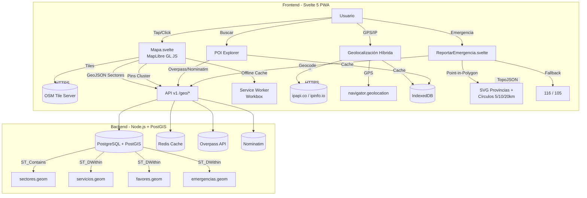
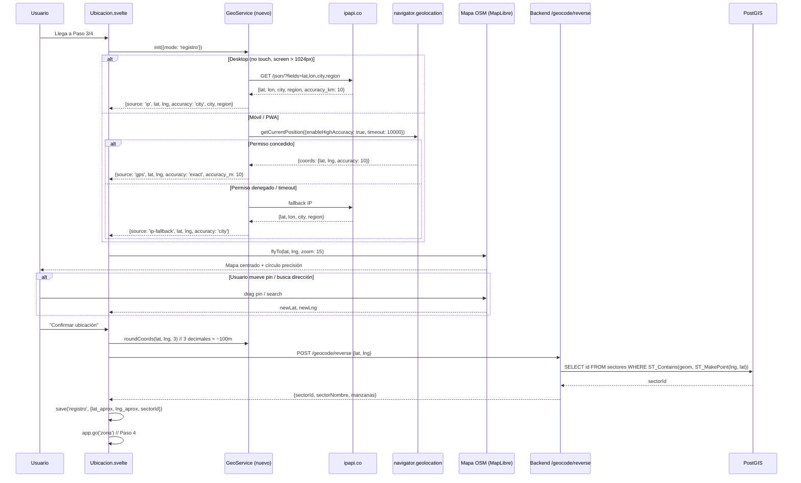
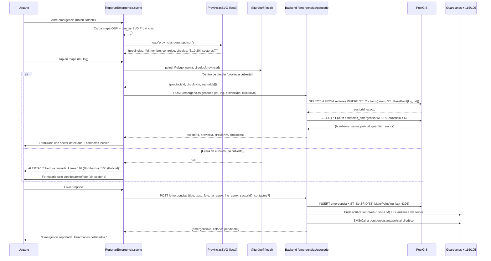
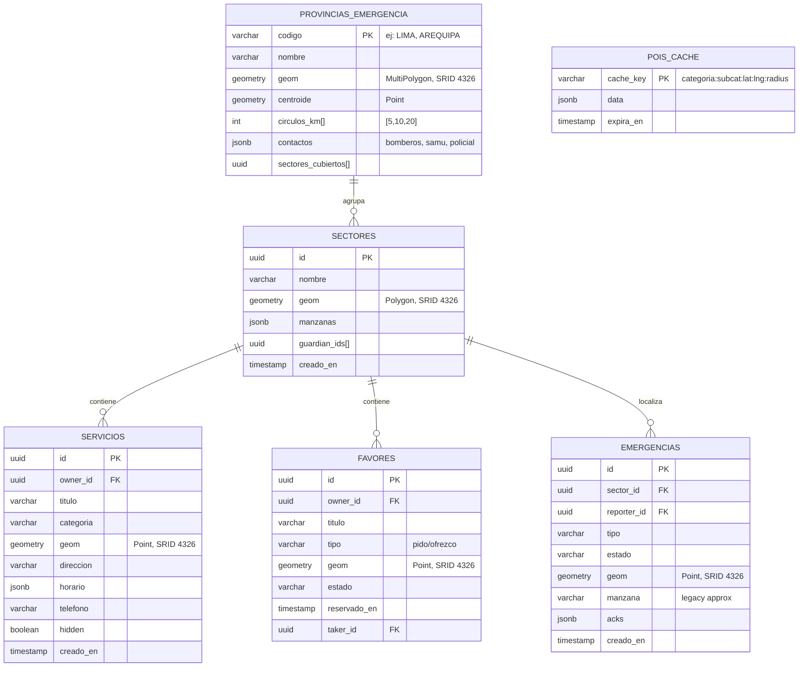
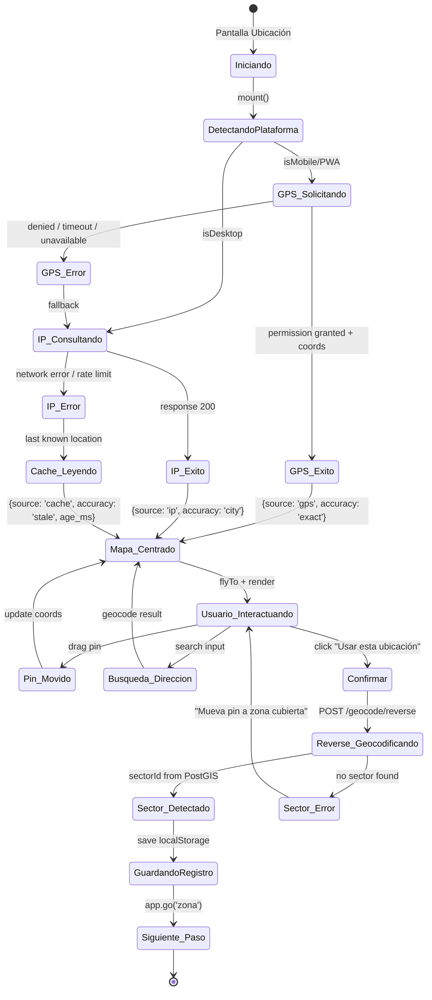

# PLAN INTEGRAL: Integración OSM + Geolocalización + POI Explorer para AYNI

**Versión:** 1.0  
**Fecha:** 2026-11-15  
**Alcance:** Frontend (SvelteKit 3 + Svelte 5) + Backend (Node.js + PostgreSQL + PostGIS)  
**Referencia:** docs/Geosocial-OSM (arquitectura geosocial de referencia)

---

## 1. RESUMEN EJECUTIVO

### Estado Actual
- **Geolocalización:** Solo `navigator.geolocation.getCurrentPosition()` con redondeo a 3 decimales (~100m), guardado como `lat_aprox`/`lng_aprox`
- **Mapa:** Grid CSS personalizado con manzanas A-F, pins posicionados por hash — **SIN tiles OSM/Leaflet**
- **Distancia:** Calculada por diferencia de letras (`cuadras()` usa `Math.abs(manzanaA.charCodeAt(0) - manzanaB.charCodeAt(0))`)
- **Backend:** PostGIS disponible pero solo usa point-in-polygon ray casting, **SIN consultas espaciales reales**
- **Dependencias:** Ninguna de OSM, Nominatim, Leaflet, Mapbox, @turf/turf

### Objetivo
Implementar **mapa real con OSM** + **geolocalización híbrida (IP + GPS)** + **explorador POI** + **geocodificación de emergencia por provincias SVG** manteniendo **offline-first** y **privacidad (aprox. 100m)**.

---

## 2. REQUISITOS FUNCIONALES

### RF-01: Geolocalización Híbrida (IP + GPS)
| ID | Requisito | Prioridad |
|----|-----------|-----------|
| RF-01.1 | Detectar automáticamente si es desktop (IP) o mobile/PWA (GPS) | 🔴 Crítica |
| RF-01.2 | API de geolocalización por IP (ipapi.co, ipinfo.io, o servicio propio) con fallback | 🔴 Crítica |
| RF-01.3 | GPS con `navigator.geolocation.watchPosition()` para tracking continuo en móvil | 🟡 Alta |
| RF-01.4 | Redondeo configurable: 3 decimales (100m) por defecto, 2 decimales (1km) para emergencias | 🟡 Alta |
| RF-01.5 | Permisos PWA: `permissions-policy: geolocation=(self)` ya configurado | ✅ Hecho |
| RF-01.6 | Cache offline de última ubicación conocida (localStorage + IndexedDB) | 🟡 Alta |
| RF-01.7 | Indicador visual de precisión: GPS exacto / IP aproximada / Cache antigua | 🟢 Media |

### RF-02: Mapa Base OSM + Leaflet/MapLibre
| ID | Requisito | Prioridad |
|----|-----------|-----------|
| RF-02.1 | Migrar `Mapa.svelte` de grid CSS a **MapLibre GL JS** (vector tiles) o **Leaflet** (raster tiles) | 🔴 Crítica |
| RF-02.2 | Tiles OSM: `https://tile.openstreetmap.org/{z}/{x}/{y}.png` (raster) o OSM Liberty (vector) | 🔴 Crítica |
| RF-02.3 | Capa de sectores (GeoJSON `area_geojson` desde backend) como polígonos clicables | 🔴 Crítica |
| RF-02.4 | Capa de manzanas (subdivisión interna del sector) | 🟡 Alta |
| RF-02.5 | Pins de servicios/favores/emergencias con clustering automático | 🟡 Alta |
| RF-02.6 | Controles: zoom, locate-me, capas (base/satélite/sectores/POI) | 🟢 Media |
| RF-02.7 | Offline: cache de tiles visitados (Service Worker + Workbox) | 🟡 Alta |
| RF-02.8 | Respeto a `prefers-reduced-motion` y accesibilidad (ARIA labels) | 🟢 Media |

### RF-03: Explorador POI (Points of Interest)
| ID | Requisito | Prioridad |
|----|-----------|-----------|
| RF-03.1 | Búsqueda POI vía **Nominatim** (OSM) o **Overpass API** (tags: amenity, shop, healthcare, emergency) | 🔴 Crítica |
| RF-03.2 | Categorías: Salud (hospital, pharmacy, clinic), Seguridad (police, fire_station), Comercio (market, supermarket), Transporte (bus_stop, taxi), Comunidad (community_centre, place_of_worship) | 🔴 Crítica |
| RF-03.3 | Filtros: distancia (500m, 1km, 2km, 5km), categoría, horario (open_now) | 🟡 Alta |
| RF-03.4 | Resultados como lista + pins en mapa, con detalles al click (nombre, dirección, teléfono, horario, distancia real) | 🟡 Alta |
| RF-03.5 | "Añadir como servicio/favor" desde POI (prefill formulario) | 🟢 Media |
| RF-03.6 | Cache offline de POIs consultados (IndexedDB, TTL 7 días) | 🟢 Media |

### RF-04: Geocodificación de Emergencia — Provincias SVG + Círculos Aproximados
| ID | Requisito | Prioridad |
|----|-----------|-----------|
| RF-04.1 | **SVG de Perú por provincias** (24/27 departamentos) como capa base vectorial | 🔴 Crítica |
| RF-04.2 | **3 provincias piloto** (Lima, Arequipa, Cusco) con **círculos concéntricos** radio 5km/10km/20km desde centroides | 🔴 Crítica |
| RF-04.3 | Escalado progresivo: 3 → 10 → 24/27 provincias con círculos generados automáticamente | 🟡 Alta |
| RF-04.4 | Al reportar emergencia: geocodificar click/tap → determinar provincia + círculo → asignar `sectorId` aproximado | 🔴 Crítica |
| RF-04.5 | Fallback: si fuera de círculos → "Ubicación no cubierta, contactar 116/105" | 🟡 Alta |
| RF-04.6 | SVG optimizado: `<path>` simplificados (topojson/simplify), < 50KB gzipped | 🟢 Media |
| RF-04.7 | Metadatos por provincia: `centroide`, `radio_km`, `sectores_cubiertos[]`, `contactos_emergencia{}` | 🟡 Alta |

### RF-05: Backend — PostGIS + API Espacial
| ID | Requisito | Prioridad |
|----|-----------|-----------|
| RF-05.1 | Habilitar extensión PostGIS en BD | 🔴 Crítica |
| RF-05.2 | Migrar `sectores.area_geojson` a `geometry(Polygon, 4326)` con índice GiST | 🔴 Crítica |
| RF-05.3 | Endpoint `POST /api/v1/geocode/reverse` → `ST_Contains(geom, ST_MakePoint(lng, lat))` | 🔴 Crítica |
| RF-05.4 | Endpoint `GET /api/v1/sectores/nearby?lat=&lng=&radius_km=` → `ST_DWithin` | 🟡 Alta |
| RF-05.5 | Endpoint `POST /api/v1/emergencias/geocode` → provincia + círculo + sector más cercano | 🔴 Crítica |
| RF-05.6 | Endpoint `GET /api/v1/pois?lat=&lng=&radius=&category=` → proxy Overpass/Nominatim con cache Redis | 🟡 Alta |
| RF-05.7 | Rate limiting: 30 req/min por IP para endpoints geo | 🟢 Media |

---

## 3. CASOS DE USO (Use Cases)

### UC-01: Registro de Usuario Nuevo — Geolocalización Inicial
```
Actor: Vecino nuevo (desktop o móvil)
Precondición: Sin sesión, en pantalla Telefono → Codigo → Nombre → Ubicación
Flujo principal:
  1. Usuario llega a pantalla Ubicación (Paso 3 de 4)
  2. Sistema detecta plataforma:
     - Desktop: llama API IP → coords aproximadas (ciudad/distrito)
     - Móvil/PWA: solicita permiso GPS → coords exactas
  3. Muestra mapa OSM centrado en coords + círculo de precisión
  4. Usuario puede: "Usar esta ubicación" / "Mover pin" / "Buscar dirección"
  5. Al confirmar: redondea a 3 decimales → guarda lat_aprox/lng_aprox + sectorId (reverse geocode)
  6. Continúa a Zona (Paso 4) con sector preseleccionado
Postcondición: Usuario registrado con ubicación y sector asignado
```

### UC-02: Mapa Principal — Explorar Servicios/Favores/POIs
```
Actor: Vecino logueado
Precondición: En pantalla Inicio → botón "Mapa" (nav bottom)
Flujo principal:
  1. Carga MapLibre/Leaflet con tiles OSM + capa sectores (GeoJSON)
  2. Centra en ubicación usuario (lat_aprox/lng_aprox) + zoom 15
  3. Muestra pins: servicios (azul), favores (verde), emergencias activas (rojo), POIs (gris)
  4. Clustering automático si > 10 pins en viewport
  5. Usuario puede:
     - Filtrar por tipo (checkboxes)
     - Buscar POI: "farmacia cerca" → llama /api/v1/pois → muestra resultados
     - Click pin → bottom sheet con detalles + "Contactar" / "Cómo llegar"
     - Botón "Mi ubicación" → flyTo + watchPosition
  6. Offline: muestra última vista cacheada + pins locales (outbox)
Postcondición: Usuario navega mapa fluidamente, descubre recursos locales
```

### UC-03: Reporte de Emergencia — Geocodificación por Provincias SVG
```
Actor: Vecino (testigo o afectado)
Precondición: Botón "Emergencia" flotante o desde InicioEmergencia
Flujo principal:
  1. Pantalla ReportarEmergencia: mapa OSM centrado en ubicación actual
  2. Capa overlay: **SVG Provincias Perú** (solo contorno) + **círculos 5/10/20km** para provincias cubiertas
  3. Usuario hace tap/click en ubicación del incidente
  4. Frontend: point-in-polygon local (Turf.js) contra círculos SVG → determina provincia + círculo
  5. Si dentro de círculo: llama `POST /api/v1/emergencias/geocode {lat, lng}`
     - Backend: ST_Contains contra sectores → sectorId exacto
     - Respuesta: { provincia, circulo_km, sectorId, contactos: {bomberos, samu, policial, guardian} }
  6. Si fuera de círculos: muestra alerta "Cobertura limitada: contacte 116 (bomberos) / 105 (policial)"
  7. Formulario: tipo (incendio, médico, seguridad, otro), texto, foto opcional
  8. Envía → crea emergencia con sectorId + coords aproximadas + contactos notificados
Postcondición: Emergencia georreferenciada, Guardianes y servicios notificados
```

### UC-04: Búsqueda POI — "Farmacia Abierta Ahora"
```
Actor: Vecino necesita medicamento
Precondición: En Mapa o Resultados
Flujo principal:
  1. Usuario escribe "farmacia" en buscador mapa / selecciona categoría "Salud"
  2. Frontend: `GET /api/v1/pois?lat=&lng=&radius_km=2&category=healthcare&open_now=true`
  3. Backend: proxy Overpass API `[out:json][timeout:10]; node["amenity"="pharmacy"](around:2000,lat,lng); out;`
  4. Backend: enriquece con Nominatim `details=1` para teléfono/horario
  5. Cache Redis 1 hora → respuesta < 200ms
  6. Frontend: muestra lista + pins en mapa, ordenados por distancia real (Haversine)
  7. Click → bottom sheet: nombre, dirección, teléfono, horario hoy, distancia, botón "Llamar" / "Abrir en OSM" / "Guardar como servicio"
Postcondición: Usuario encuentra recurso real verificado
```

---

## 4. HISTORIAS DE USUARIO (User Stories)

| ID | Historia | Criterios de Aceptación |
|----|----------|-------------------------|
| **US-GEO-01** | Como vecino nuevo en **desktop**, quiero que la app detecte mi ciudad automáticamente por IP para no tener que escribir mi ubicación | - Pantalla Ubicación muestra mapa centrado en mi ciudad (precisión ~10-50km)<br>- Indicador "Ubicación por IP (aproximada)" visible<br>- Puedo mover pin o buscar dirección para corregir |
| **US-GEO-02** | Como vecino en **móvil/PWA**, quiero usar mi GPS preciso para ubicarme en el mapa y registrar mi sector exacto | - Permiso GPS solicitado una sola vez<br>- Mapa centrado en mi posición (precisión ~10m)<br>- Círculo de precisión visible<br>- Sector detectado automáticamente via reverse geocode |
| **US-GEO-03** | Como vecino, quiero ver un **mapa real con calles y edificios** (no un grid abstracto) para orientarme y encontrar servicios | - Tiles OSM cargan en < 3s (3G)<br>- Capa sectores visible como polígonos semitransparentes<br>- Pins de servicios/favores clicables<br>- Zoom/pan fluido 60fps |
| **US-GEO-04** | Como vecino, quiero **buscar "farmacia cerca"** y ver cuáles están abiertas ahora con teléfono y horario | - Búsqueda devuelve resultados en < 500ms (cache)<br>- Cada resultado muestra: nombre, distancia real (m), horario hoy, teléfono<br>- Pin en mapa coincide con lista<br>- Botón "Llamar" abre `tel:` / "Cómo llegar" abre OSM/Google Maps |
| **US-GEO-05** | Como vecino, quiero **reportar un incendio** y que la app sepa automáticamente en qué provincia/distrito/sector estoy para notificar a los Guardianes y bomberos correctos | - Click en mapa → determina provincia + círculo en < 100ms (local)<br>- Si cubierto: sectorId exacto via backend PostGIS<br>- Contactos de emergencia locales incluidos en respuesta<br>- Si no cubierto: mensaje claro con números 116/105 |
| **US-GEO-06** | Como **Guardián**, quiero ver en el mapa las emergencias activas con su ubicación real (no solo manzana) para coordinar respuesta | - PanelGuardian muestra mapa OSM con emergencias como pins rojos pulsantes<br>- Click emergencia → flyTo + detalles + botón "Confirmar" / "Descartar"<br>- Filtro por tipo / estado / radio |
| **US-GEO-07** | Como vecino **sin conexión**, quiero ver el mapa de mi zona y mis servicios/favores guardados | - Service Worker cachea tiles visitados (última sesión)<br>- Pins locales (IndexedDB) se muestran aunque offline<br>- Indicador "Modo offline - datos locales" visible |
| **US-GEO-08** | Como desarrollador, quiero que la **migración del grid CSS a OSM** no rompa el flujo de registro (Paso 3/4) ni el mapa de emergencias | - Ubicación.svelte: mismo contrato (lat_aprox, lng_aprox, sectorId)<br>- ReportarEmergencia: mismo contrato + provincia/círculo<br>- Tests E2E pasan en CI |

---

## 5. DIAGRAMAS DE PROGRAMACIÓN (Mermaid)

### 5.1 Arquitectura General — Flujo de Datos Geo



### 5.2 Flujo Registro — Paso 3: Ubicación (Geolocalización Híbrida)



### 5.3 Flujo Emergencia — Geocodificación Provincias SVG + Círculos



### 5.4 Flujo POI Explorer — Búsqueda "Farmacia Abierta"

```mermaid
sequenceDiagram
    participant U as Usuario
    participant M as Mapa.svelte
    participant POI as POIService (nuevo)
    participant API as Backend /pois
    participant Redis as Redis Cache
    participant Overpass as Overpass API
    participant Nominatim as Nominatim
    
    U->>M: Click buscador / Categoría "Salud"
    M->>POI: search({category: 'healthcare', subcategory: 'pharmacy', radiusKm: 2, openNow: true})
    POI->>API: GET /pois?lat=-12.04&lng=-77.03&radius=2&category=healthcare&sub=pharmacy&open=1
    API->>Redis: GET poi:healthcare:pharmacy:-12.04:-77.03:2
    alt Cache HIT
        Redis-->>API: [{osm_id, name, lat, lng, tags...}, ...]
    else Cache MISS
        API->>Overpass: [out:json][timeout:10]; node["amenity"="pharmacy"](around:2000,-12.04,-77.03); out;
        Overpass-->>API: {elements: [{id, lat, lon, tags}, ...]}
        API->>Nominatim: GET /details?osmtype=N&osmid=123 (paralelo para cada resultado)
        Nominatim-->>API: {address, phone, opening_hours, website}
        API->>API: Enriquecer + calcular distancia Haversine + filtrar open_now
        API->>Redis: SETEX poi:... 3600 {resultados}
        API-->>POI: {pois: [{id, name, lat, lng, dist_m, phone, hours, open_now}, ...]}
    end
    POI-->>M: lista + pins
    M->>U: Bottom sheet con lista ordenada por distancia
    U->>M: Click "Farmacia Central - 350m - Abierta hasta 22:00"
    M->>U: Detalles + botones: Llamar / Cómo llegar / Guardar como servicio
```

### 5.5 Modelo de Datos — Extensiones PostGIS



### 5.6 Diagrama de Estados — Geolocalización Híbrida



---

## 6. PLAN TÉCNICO DE IMPLEMENTACIÓN

### 6.1 Fase 1: Fundación Backend (Semana 1-2)

| Tarea | Archivos | Esfuerzo |
|-------|----------|----------|
| Habilitar PostGIS en BD + migración `geom` | `backend/migraciones/002_postgis_geom.sql` | 8h |
| Índices GiST en `sectores.geom`, `servicios.geom`, `favores.geom`, `emergencias.geom` | `backend/migraciones/002_postgis_geom.sql` | 4h |
| Repositorio `sectores.ts`: `findByPoint(lat, lng)` usando `ST_Contains` | `backend/src/lib/server/repositorios/sectores.ts` | 6h |
| Endpoint `POST /api/v1/geocode/reverse` | `backend/src/routes/api/v1/geocode/reverse/+server.ts` | 8h |
| Endpoint `GET /api/v1/sectores/nearby` con `ST_DWithin` | `backend/src/routes/api/v1/sectores/nearby/+server.ts` | 6h |
| Tabla `provincias_emergencia` + seed data (24 provincias + centroides + círculos) | `backend/migraciones/003_provincias_emergencia.sql` | 8h |
| Endpoint `POST /api/v1/emergencias/geocode` | `backend/src/routes/api/v1/emergencias/geocode/+server.ts` | 8h |
| Proxy Overpass/Nominatim + Redis cache | `backend/src/lib/server/servicios/pois.ts` | 12h |
| Endpoint `GET /api/v1/pois` | `backend/src/routes/api/v1/pois/+server.ts` | 6h |

**Total Fase 1: ~66h**

### 6.2 Fase 2: Geolocalización Híbrida Frontend (Semana 2-3)

| Tarea | Archivos | Esfuerzo |
|-------|----------|----------|
| Servicio `GeoService` (clase/state) con IP + GPS + Cache | `frontend/src/lib/geo/GeoService.svelte.js` | 12h |
| Componente `MapaOSM.svelte` wrapper MapLibre GL JS | `frontend/src/lib/ui/MapaOSM.svelte` | 16h |
| Refactor `Ubicacion.svelte` → usar `GeoService` + `MapaOSM` | `frontend/src/lib/pantallas/acceso/Ubicacion.svelte` | 12h |
| Indicador visual precisión (GPS exacto / IP aprox / Cache) | `frontend/src/lib/ui/GeoPrecisionBadge.svelte` | 4h |
| Tests unitarios GeoService (mock IP/GPS) | `frontend/src/lib/geo/GeoService.test.js` | 8h |
| E2E: Registro completo desktop + móvil | `frontend/tests/e2e/registro-geo.spec.ts` | 8h |

**Total Fase 2: ~60h**

### 6.3 Fase 3: Mapa Principal + POI Explorer (Semana 3-4)

| Tarea | Archivos | Esfuerzo |
|-------|----------|----------|
| Migrar `Mapa.svelte` a `MapaOSM.svelte` + capas sectores/pins | `frontend/src/lib/pantallas/Mapa.svelte` | 20h |
| Clustering pins (supercluster) | `frontend/src/lib/map/clustering.ts` | 8h |
| Offline tiles: Workbox config + Service Worker | `frontend/public/sw.js`, `vite.config.ts` | 12h |
| POI Explorer: buscador + categorías + filtros | `frontend/src/lib/pantallas/servicios/POIExplorer.svelte` | 16h |
| Bottom sheet detalles POI + acciones (llamar, cómo llegar, guardar) | `frontend/src/lib/ui/POIDetailSheet.svelte` | 8h |
| Cache POI IndexedDB (idb library) | `frontend/src/lib/storage/poiCache.ts` | 6h |
| Integración en `Resultados.svelte` + `Inicio.svelte` | `frontend/src/lib/pantallas/servicios/*.svelte` | 8h |

**Total Fase 3: ~78h**

### 6.4 Fase 4: Emergencia + Provincias SVG (Semana 4-5)

| Tarea | Archivos | Esfuerzo |
|-------|----------|----------|
| Generar TopoJSON Perú provincias simplificado (< 50KB) | `scripts/generar-provincias-topojson.js` | 8h |
| Componente `ProvinciasSVGOverlay.svelte` (MapLibre layer) | `frontend/src/lib/map/ProvinciasSVGOverlay.svelte` | 12h |
| Lógica point-in-polygon círculos (Turf.js) | `frontend/src/lib/geo/emergenciaGeocode.ts` | 8h |
| Refactor `ReportarEmergencia.svelte` → mapa + overlay SVG | `frontend/src/lib/pantallas/emergencia/ReportarEmergencia.svelte` | 16h |
| Integración backend `/emergencias/geocode` + contactos | `frontend/src/lib/acciones.js` (nueva `reportarEmergenciaGeo`) | 8h |
| PanelGuardian: mapa emergencias activas + flyTo | `frontend/src/lib/pantallas/perfil/PanelGuardian.svelte` | 12h |
| Tests: 3 provincias piloto → 24 provincias | `frontend/tests/e2e/emergencia-geo.spec.ts` | 8h |

**Total Fase 4: ~72h**

### 6.5 Fase 5: Pulido, Accesibilidad, Offline, Docs (Semana 5-6)

| Tarea | Archivos | Esfuerzo |
|-------|----------|----------|
| Accesibilidad: ARIA labels, keyboard nav, reduced motion | Todos componentes mapa/geo | 12h |
| i18n: keys para geo (es/qu/ay) | `frontend/src/lib/i18n/languages.js` | 6h |
| Performance: lazy load MapLibre, code splitting | `vite.config.ts`, imports dinámicos | 8h |
| Documentación técnica + guía usuario | `docs/GEO-OSM-INTEGRACION.md` | 8h |
| Bug bash + QA móvil real (Android/iOS PWA) | Dispositivos físicos | 16h |

**Total Fase 5: ~50h**

---

## 7. ESTIMACIÓN TOTAL

| Fase | Horas | Semanas |
|------|-------|---------|
| 1. Backend PostGIS + API | 66h | 1.5 |
| 2. Geolocalización Híbrida | 60h | 1.5 |
| 3. Mapa + POI Explorer | 78h | 2 |
| 4. Emergencia + SVG Provincias | 72h | 2 |
| 5. Pulido + QA | 50h | 1.5 |
| **TOTAL** | **326h** | **~8.5 semanas** |

**Buffer 20%:** ~65h → **~390h / 10 semanas / 2.5 meses**

---

## 8. DEPENDENCIAS NUEVAS

### Frontend (`frontend/package.json`)
```json
{
  "dependencies": {
    "maplibre-gl": "^4.7.0",
    "@turf/turf": "^7.1.0",
    "idb": "^8.0.0",
    "supercluster": "^8.0.1"
  },
  "devDependencies": {
    "@types/maplibre-gl": "^4.7.0",
    "workbox": "^7.1.0"
  }
}
```

### Backend (`backend/package.json`)
```json
{
  "dependencies": {
    "pg": "^8.11.0",
    "knex": "^3.1.0",
    "ioredis": "^5.3.0",
    "node-fetch": "^3.3.0"
  }
}
```
> Nota: PostGIS se habilita en BD, no requiere dependencia npm extra. Knex soporta `postgis` via `knex-postgis` o raw SQL.

---

## 9. ARCHIVOS CLAVE A MODIFICAR/CREAR

### Backend (Nuevos)
```
backend/
├── migraciones/
│   ├── 002_postgis_geom.sql
│   └── 003_provincias_emergencia.sql
├── src/routes/api/v1/
│   ├── geocode/reverse/+server.ts
│   ├── sectores/nearby/+server.ts
│   ├── emergencias/geocode/+server.ts
│   └── pois/+server.ts
├── src/lib/server/repositorios/
│   └── sectores.ts (extendido)
├── src/lib/server/servicios/
│   ├── pois.ts (nuevo)
│   └── emergencias.ts (extendido)
└── src/lib/server/dto.ts (extendido con geom)
```

### Frontend (Nuevos)
```
frontend/src/lib/
├── geo/
│   ├── GeoService.svelte.js
│   ├── emergenciaGeocode.ts
│   └── GeoService.test.js
├── map/
│   ├── clustering.ts
│   ├── ProvinciasSVGOverlay.svelte
│   └── MapaOSM.svelte
├── ui/
│   ├── MapaOSM.svelte
│   ├── GeoPrecisionBadge.svelte
│   └── POIDetailSheet.svelte
├── pantallas/
│   ├── servicios/POIExplorer.svelte
│   ├── emergencia/ReportarEmergencia.svelte (refactor)
│   ├── acceso/Ubicacion.svelte (refactor)
│   └── perfil/PanelGuardian.svelte (extendido)
└── storage/
    └── poiCache.ts
```

### Scripts / Assets
```
scripts/
├── generar-provincias-topojson.js
└── seed-provincias-emergencia.js

public/
├── sw.js (Workbox)
└── assets/mapas/
    └── peru-provincias.topojson (~50KB gzipped)
```

---

## 10. RIESGOS Y MITIGACIONES

| Riesgo | Probabilidad | Impacto | Mitigación |
|--------|--------------|---------|------------|
| Tiles OSM lentos en 3G/offline | 🔴 Alta | 🔴 Alto | Workbox cache-first + tiles vectoriales (MapLibre) + fallback raster |
| Rate limit Nominatim/Overpass | 🟡 Media | 🟡 Medio | Proxy backend + Redis cache (1h) + rate limit propio 30/min |
| PostGIS no instalado en prod | 🟢 Baja | 🔴 Crítico | Verificar en CI/CD + migración idempotente + script verificación |
| SVG provincias muy pesado | 🟡 Media | 🟡 Medio | TopoJSON + simplify (Visvalingam) + gzip < 50KB |
| Permisos GPS denegados en PWA | 🔴 Alta | 🟡 Medio | Fallback IP automático + UI clara "Activar ubicación en ajustes" |
| Precisión 100m insuficiente para emergencias | 🟡 Media | 🔴 Alto | Opción 2 decimales (1km) para emergencias + círculos SVG amplios |
| Migración rompe registro existente | 🟢 Baja | 🔴 Crítico | Tests E2E completos + feature flag `geo_v2` + rollback plan |
| Offline-first roto por tiles | 🟡 Media | 🟡 Medio | Service Worker precache tiles visitados + pins locales siempre visibles |

---

## 11. MÉTRICAS DE ÉXITO (KPIs)

| Métrica | Objetivo | Medición |
|---------|----------|----------|
| Tiempo carga mapa inicial (3G) | < 3s | Web Vitals LCP en `Mapa.svelte` |
| Tiempo geolocalización IP | < 800ms | `GeoService` timing |
| Tiempo geolocalización GPS | < 5s (timeout 10s) | `navigator.geolocation` |
| Precisión sector detectado | > 95% | Logs backend `/geocode/reverse` |
| Cobertura provincias emergencia | 100% (24/27) | Seed data + test automatizado |
| Cache hit rate POI | > 80% | Redis metrics |
| Funcionalidad offline | 100% pins locales | E2E test sin red |
| Accesibilidad (axe-core) | 0 violations críticos | CI pipeline |

---

## 12. PRÓXIMOS PASOS INMEDIATOS

1. **Crear branch `feat/geo-osm-integration`**
2. **Fase 1.1:** Migración PostGIS + habilitar extensión en BD local + CI
3. **Fase 1.2:** Endpoint `/geocode/reverse` + test con sector existente
4. **Fase 2.1:** `GeoService` con IP + GPS + Cache (TDD)
5. **Fase 2.2:** `MapaOSM.svelte` wrapper MapLibre + tiles OSM
6. **Validar:** Registro completo desktop + móvil en staging

---

## 13. REFERENCIAS

- **docs/Geosocial-OSM** — Arquitectura geosocial de referencia (tiles vectoriales, clustering, offline-first)
- **OSM Tile Policy** — https://operations.osmfoundation.org/policies/tiles/
- **Nominatim Usage Policy** — https://nominatim.org/release-docs/latest/admin/Usage-Policy/
- **Overpass API** — https://overpass-api.de/
- **MapLibre GL JS** — https://maplibre.org/maplibre-gl-js/docs/
- **PostGIS Docs** — https://postgis.net/documentation/
- **Workbox** — https://developer.chrome.com/docs/workbox/
- **@turf/turf** — https://turfjs.org/

---

*Documento generado automáticamente basado en análisis de código base AYNI (HK2026ECUTP-Wolfbyte 800)*